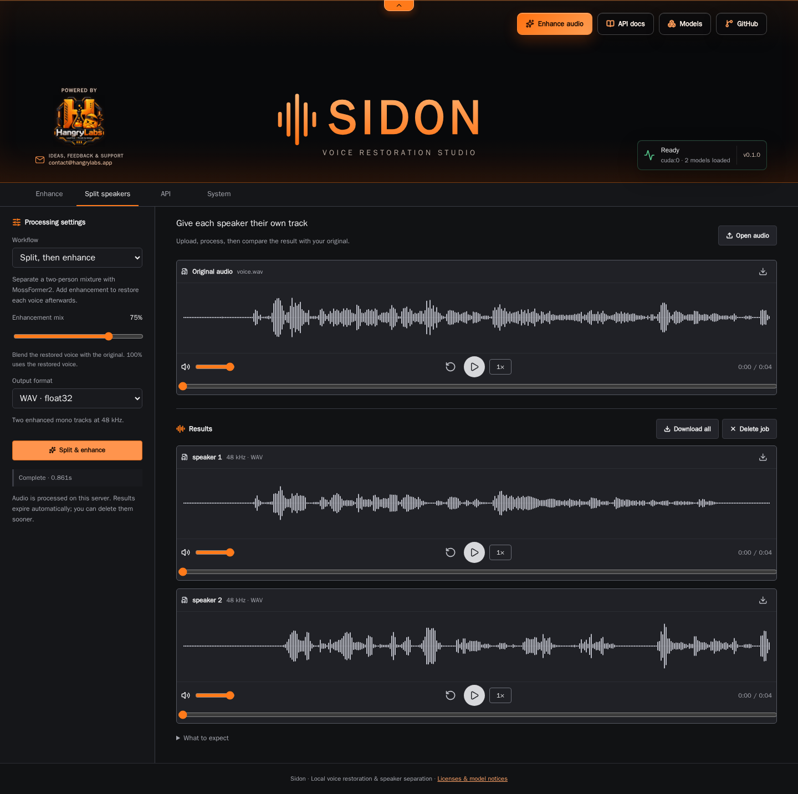

<p align="center"></p>

<p align="center"><a href="https://hangry-labs.github.io/Sidon/examples/?lang=en"><strong>🎧 Hear the before-and-after comparison</strong></a></p>

Development version **v1.0.0-snapshot**, targeting the first **v1.0.0** release.
See the [version history](#version-history).

Restore noisy or degraded speech, split a two-speaker mixture, and listen to the results in a local Hangry Labs studio. One Docker container serves the browser UI, audio-job API and models.

This is an inference-focused fork of [sarulab-speech/Sidon](https://github.com/sarulab-speech/Sidon). It uses Sidon's single-speaker restoration exports and Apache-licensed MossFormer2 for separation. Training and dataset preparation are outside this product's scope.

The [project website](https://hangry-labs.github.io/Sidon/) presents this README
and the documentation in the shared Hangry Labs theme. Its
[listening examples](https://hangry-labs.github.io/Sidon/examples/?lang=en) compare
three low-quality VoxCPMTTS outputs with their recordings after Sidon restoration.

## Run locally

Build the full image with baked, checksum-verified CPU and CUDA weights:

```bash
docker build --target baked -t sidon:local .
docker run -d --name sidon --gpus all -p 127.0.0.1:7868:7868 -v sidon_data:/app/persistent sidon:local
```

Open **http://localhost:7868**. NVIDIA GPU support requires a CUDA 13-compatible host driver and NVIDIA container support. The image targets **Linux x86-64, Python 3.13 and CUDA 13.0 / PyTorch 2.14**. It can also run on CPU: omit `--gpus all` and add `-e SIDON_DEVICE=cpu`. CPU processing is slower.

On supported CUDA systems, automatic restoration selects an optimized F32 path:
a fused vocoder activation for all clips, plus a folded encoder and strict F32
math for longer windows. Shorter windows preserve the reference encoder and
arithmetic. CPU and unsupported hosts use the original TorchScript exports.
The first optimized load compiles a small kernel; the data volume retains it.

Or use `docker compose up -d --build`. The supplied Compose configuration requests a GPU and binds the UI to localhost.

The full image reads weights directly from its baked model directory and does not need a first-run download. The five assets occupy about 2.68 GB before runtime dependencies. Keep the single data volume for settings and audio jobs.

## What the studio does

| Workflow | Result |
| --- | --- |
| Enhance | Sidon restores a single voice; mono 48 kHz output, with an original/restored mix control |
| Split speakers | MossFormer2 separates a mixture into two mono 16 kHz tracks |
| Split, then enhance | Separates first, then restores each track; two mono 48 kHz outputs |
| Convert only | Changes audio format without loading a model; preserves channels (MP3 exports support up to two) |

Upload WAV, FLAC, Opus, MP3, AAC/M4A, OGG, AIFF, WebM audio or another supported audio recording. Enhancement/separation downmix to mono; Convert preserves channels. Download WAV (float32), FLAC (24-bit), Opus (96 kbps VBR), MP3 (192 kbps), AAC/M4A (192 kbps) or Ogg Vorbis (quality 5), individually or in a ZIP manifest. WAV/FLAC preserve the workflow sample rate; compressed exports use 48 kHz. Float WAV retains samples above full scale; FLAC clips them and the UI reports that condition. See [audio formats](docs/audio-formats.md).

System provides model load/unload controls, server defaults, retained-job history and demand-driven GPU charts. Models also load automatically when a job needs them. Settings survive container replacement through the data volume.



Restoration resynthesizes speech. It can change timbre or add artifacts and does not recover missing words reliably. Separation always returns two tracks; speaker labels are relative to the first window, and ambiguous overlaps can swap them. Neither path is speaker identification. Compare representative generated voices before adopting a preset.

## Smaller image and cache

```bash
docker build --target tiny -t sidon:tiny .
docker run -d --name sidon-tiny --gpus all -p 127.0.0.1:7868:7868 -v sidon_data:/app/persistent sidon:tiny
```

The tiny image has the same UI and runtime but downloads a model's pinned weights on first use. Keep `/app/persistent` to reuse the cache. Download every model/device variant you need before disconnecting: CPU and CUDA restoration exports are different files. Restart with the same volume and `-e HF_HUB_OFFLINE=1` for cached operation.

## Image publication

Rolling images are published to `hangrylabs/sidon` and `ghcr.io/hangry-labs/sidon`
after successful main builds. Stable releases appear only after their tag build
and registry verification; see [release preparation](docs/releasing.md).

| Trigger | Full | Tiny | Corresponding sources |
| --- | --- | --- | --- |
| Push to main | `latest` | `latest_tiny` | `latest_sources` plus an immutable build identity |
| Existing stable Git tag | `vX.Y` or `vX.Y.Z` | matching `_tiny` | matching `_sources` plus an immutable build identity |

Stable tags are never overwritten. Tag builds do not move `latest`; manual publication can explicitly opt in. Sources publish before binary images, and both registries' resulting index digests are checked. Publication evidence includes runtime notices, exact installed versions, model hashes and a verified source manifest. See [Docker packaging](docs/docker-packaging.md) and the [Docker Hub description](docs/dockerhub.md).

## API

The public `/v1` API uses OpenAI-style authentication, `model`, `response_format`,
model discovery and structured errors. Audio restoration/separation/conversion
are **native Sidon extensions**, not OpenAI speech endpoints. There is no streaming:
clients submit each complete chunk independently. See the [API guide](docs/api.md).

```bash
curl http://localhost:7868/v1/models
curl -X POST http://localhost:7868/v1/audio/enhancements -F file=@voice.wav -F response_format=opus --output restored.opus
curl -X POST http://localhost:7868/v1/audio/conversions -F file=@voice.m4a -F response_format=flac --output converted.flac
```

Direct requests wait for an audio file (or a two-track ZIP for separations).
Add `response_mode=job` for HTTP 202, then use `/v1/audio/jobs/JOB_ID` to poll,
download or cancel. `/v1/audio/queue` reports live admission and processing counts.
Versioned requests use fixed documented defaults independent of Studio settings.

The existing Studio job API remains supported, including its saved defaults and
legacy error shape. Examples below use Bash/cURL (`curl.exe` avoids PowerShell's legacy alias).

```bash
curl -X POST http://localhost:7868/api/jobs -F file=@voice.wav -F mode=enhance -F strength=1 -F output_format=wav
curl http://localhost:7868/api/jobs/JOB_ID
curl -OJ http://localhost:7868/api/jobs/JOB_ID/files/results.zip
curl -X DELETE http://localhost:7868/api/jobs/JOB_ID
```

Submission returns HTTP 202 with an `id`. Poll until `status` is `done`, `failed` or `cancelled`. Completed jobs list each track's filename, sample rate, channels, duration and count of source samples above full scale. Use `mode=separate`, `mode=separate_enhance`, or `mode=convert`. Output formats are `wav`, `flac`, `opus`, `mp3`, `m4a`, `aac`, and `ogg`. Defaults are read when a job is submitted.

Completed jobs and ZIP manifests also record the selected inference backends and
runtime version, so results can be traced to the processing path used.

Discovery: `GET /healthz`, `GET /api/status`, `GET /api/jobs`, and `/openapi.json`. Persist defaults with `PUT /api/settings`. Manage residency with `POST /api/models/enhance` or `/api/models/separate` and JSON `{"action":"load"}` or `{"action":"unload"}`. GPU telemetry is `/api/gpu`. The UI's API tab has the same examples.

When `SIDON_API_KEY` is set, all `/api/*` and `/v1/*` requests require `Authorization: Bearer YOUR_KEY`; enter it in System for browser use. Health, static assets and the API schema remain public. All authorized clients of an instance share its jobs and settings. For hosted workloads, isolate tenants in separate instances and place TLS/access controls at your reverse proxy.

## Runtime settings

| Variable | Default | Purpose |
| --- | --- | --- |
| `SIDON_DEVICE` | `auto` | CUDA when available, otherwise CPU; explicit `cpu` or logical `cuda:0` |
| `SIDON_RESTORATION_BACKEND` | `auto` | Adaptive optimized CUDA path when supported; `torchscript` forces reference, `native` forces strict F32 native execution on all windows |
| `SIDON_HOST` | `127.0.0.1` locally; `0.0.0.0` in Docker | Server bind address |
| `SIDON_PORT` | `7868` | HTTP port; update mapping and healthcheck if changed |
| `SIDON_DATA_DIR` | `/app/persistent/studio` in Docker | Defaults and retained audio jobs |
| `HF_HOME` | `/app/persistent/huggingface` in Docker | Tiny-image model cache |
| `TRITON_CACHE_DIR` | `/app/persistent/triton` in Docker | Compiled activation/launcher cache; contains no audio |
| `SIDON_MODEL_DIR` | `/app/baked-models` in full image | Verified baked model assets |
| `HF_HUB_OFFLINE` | full `1`, tiny `0` | Disallow or allow model downloads |
| `SIDON_MAX_UPLOAD_MB` | `100` | Maximum file size |
| `SIDON_MAX_AUDIO_SECONDS` | `600` | Maximum decoded clip duration |
| `SIDON_MAX_ACTIVE_JOBS` | `4` | Total upload/validation/queued/running slots, from 1 to 64; overflow returns 429 with Retry-After |
| `SIDON_RETENTION_HOURS` | `24` | Automatic uploaded/generated audio expiry |
| `SIDON_API_KEY` | unset | Optional shared bearer key |

The default is four active jobs sharing one processing worker. Ready jobs run FIFO;
uploads count toward admission before multipart parsing. Pending cancellation frees
its slot immediately; running cancellation waits for a safe boundary. Queue position
and wait/processing/total timings are exposed through the API. An OS lock prevents
multiple server processes from owning one data directory. Run one instance per GPU
allocation; separate instances do not coordinate their queues. Use `--gpus device=0`
to select a physical GPU; the published Sidon CUDA export uses logical `cuda:0`.
Separation windows default to four seconds with one-second overlaps; adjust and save
them in System, or pass per-request window settings to the versioned API.

## Development

```bash
uv sync --locked
uv run --locked sidon-studio
uv run --locked pytest -q
```

The project lock uses the CUDA 13.0 PyTorch index explicitly. Docker installs a separate fully hashed Linux/CPython 3.13 runtime lock. Regenerate it with `pwsh -File scripts/lock-runtime.ps1`; check it with `-Check 1`. `Taskfile.yml` provides matching setup, studio, test and image tasks.

Reviewed dependency fixes and GPU compatibility changes are recorded in the [security review](docs/security.md).

Release preparation follows [the release guide](docs/releasing.md): `task release DRY_RUN=1`
previews both version transitions; `task release` validates, creates the stable tag
and next snapshot, then pushes both refs for container publication.

Native installations also need `ffmpeg` and `ffprobe` on PATH for compressed
exports and additional upload formats. Both are included in the Docker images.

Preview the README-driven project website with `task pages`, or build it with
`task pages-build`. The separate static-site builder uses no inference models or
GPU. See the [website guide](site/README.md) for preview and Pages configuration.

The separation CLI remains available:

```bash
uv run --locked sidon-separate --input dialogue.wav --output-dir separated
```

Its output folders contain two float WAVs and `run.json`. It rejects existing output folders. See [separation details](docs/mossformer-runtime.md) and [validation notes](docs/validation.md).

For cold/warm latency measurements and the audio.cpp implementation comparison,
see [performance notes](docs/performance.md).

## Version History

<details open markdown="1">
<summary><strong>v1.0.0-snapshot development notes</strong></summary>

### v1.0.0-snapshot

Development toward the first `v1.0.0` release, with Python package version `1.0.0.dev0`.
Rolling `latest` and `latest_tiny` images follow `main` after successful
publication. Stable release tags remain immutable. The snapshot label describes
development status; it is not a Docker tag.

The following commands use published rolling images. For a local source build,
use the [local build commands](#run-locally).

**Rolling full image**

```bash
docker run -d --name sidon --restart unless-stopped --gpus all -p 127.0.0.1:7868:7868 -v sidon_data:/app/persistent hangrylabs/sidon:latest
```

**Rolling tiny image**

```bash
docker run -d --name sidon --restart unless-stopped --gpus all -p 127.0.0.1:7868:7868 -v sidon_data:/app/persistent hangrylabs/sidon:latest_tiny
```

Choose full or tiny and reuse the same persistent volume when replacing the
container. Full includes all pinned weights; tiny downloads them on first use.
For GHCR, replace `hangrylabs/sidon` with `ghcr.io/hangry-labs/sidon`.
Matching rolling sources use `latest_sources`; see [source extraction and
rebuilding](docs/docker-packaging.md). Published stable versions will be recorded
here with their source tags and verified full, tiny and source OCI index digests.

- Focus the fork on inference: remove training and dataset-preparation code and
  replace the noncommercial DialogueSidon dependency with MossFormer2 separation.
- Provide single-voice enhancement, two-speaker separation and separation followed
  by enhancement through the browser studio and audio-job API.
- Add original/result waveform players, float WAV and 24-bit FLAC downloads,
  ZIP manifests, retained-job history, model residency controls and GPU telemetry.
- Package Python 3.13, PyTorch 2.14 and CUDA 13.0 with locked runtime dependencies,
  checksum-verified model assets, full/tiny images and matching source images.
- Preserve component notices and corresponding sources alongside Apache-2.0
  project contributions and retained upstream licenses.
- Avoid repeated TorchScript optimization stalls and shorten job-status polling
  for fast requests. Add adaptive CUDA restoration with folded LoRA projections,
  projected relative attention and a fused F32 vocoder activation. See the
  [measurements and precision tradeoffs](docs/performance.md).
- Persist model and compiled-kernel caches, settings and retained audio through
  one volume; record runtime versions and selected backends in job manifests.
- Add model-free format conversion, broader uploads through FFmpeg, and WAV,
  FLAC, Opus, MP3, AAC/M4A and Vorbis downloads across all workflows.
- Add versioned native audio endpoints with OpenAI-style conventions, direct or
  asynchronous responses, bounded FIFO admission, queue timings and safe cancellation.
- Fix the reviewed dependency advisories with PyTorch 2.14.1 / CUDA 13.0 and
  refreshed locks, notices and matching sources; validate the actual JIT regression
  as well as package versions. Add recovery fixes and a tested release task.

</details>

## Privacy, attribution and licenses

Processing runs on your server. The full image's core UI and inference work without an external network. Tiny images contact Hugging Face to download weights. Audio and results are kept in the server data volume until deletion or expiry; expiry runs at startup and about once per minute. Deleting a job removes its server files, but not copies already downloaded by a client. Browser input files stay in page memory until the page closes.

Sidon restoration is credited to sarulab-speech; MossFormer2 to its authors and ClearerVoice-Studio. The UI shell and packaging conventions are adapted from Hangry Labs faster-qwen3-tts-studio, retaining its MIT notice. Lucide icons retain their license.

Our contributions use [Apache-2.0](LICENSE). Retained source includes MIT material and ISC-licensed Lucide assets, so the package expression is **Apache-2.0 AND MIT AND ISC**. Sidon restoration weights are publisher-declared MIT; MossFormer2 weights are publisher-declared Apache-2.0. Model grants are distinct from training-data provenance or rights to uploaded audio.

Complete containers also include third-party LGPL/GPL runtime components and NVIDIA binaries under their own terms. Corresponding sources, build inputs and notices are supplied by the `sources` target; the application license does not replace those terms. See [licensing](docs/licensing.md), [runtime notices](RUNTIME_NOTICES.md) and [third-party notices](THIRD_PARTY_NOTICES.md).

Feedback and support: [contact@hangrylabs.app](mailto:contact@hangrylabs.app).
